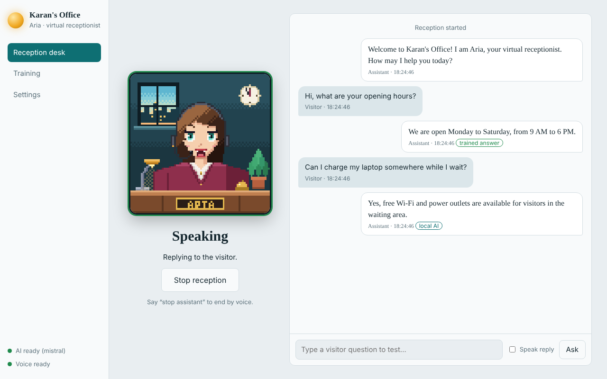
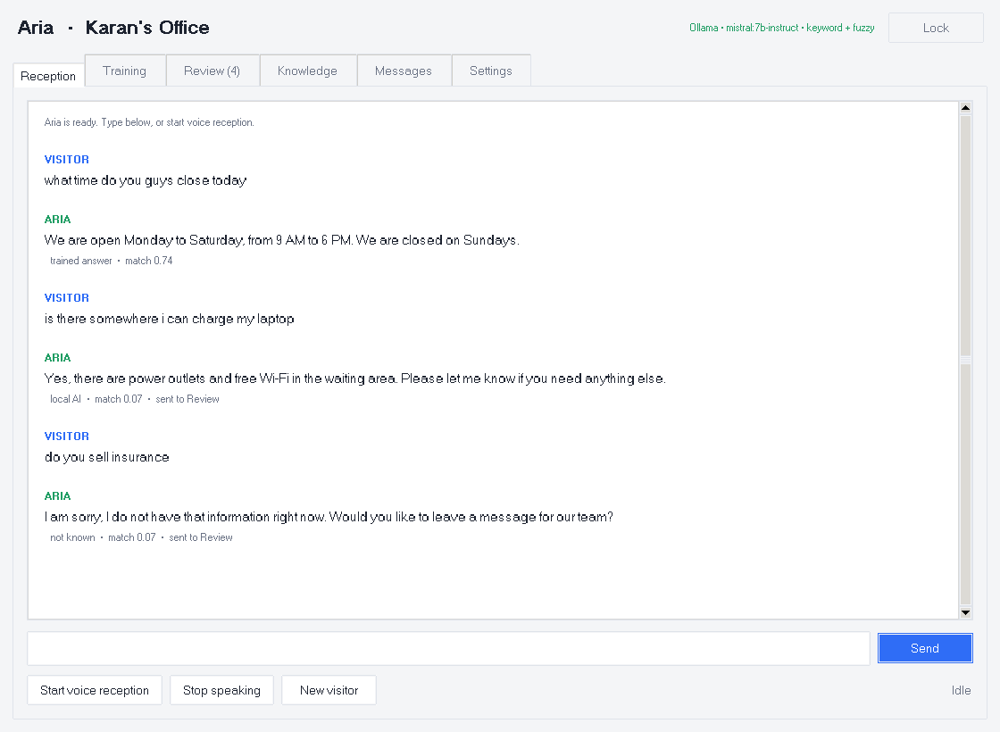
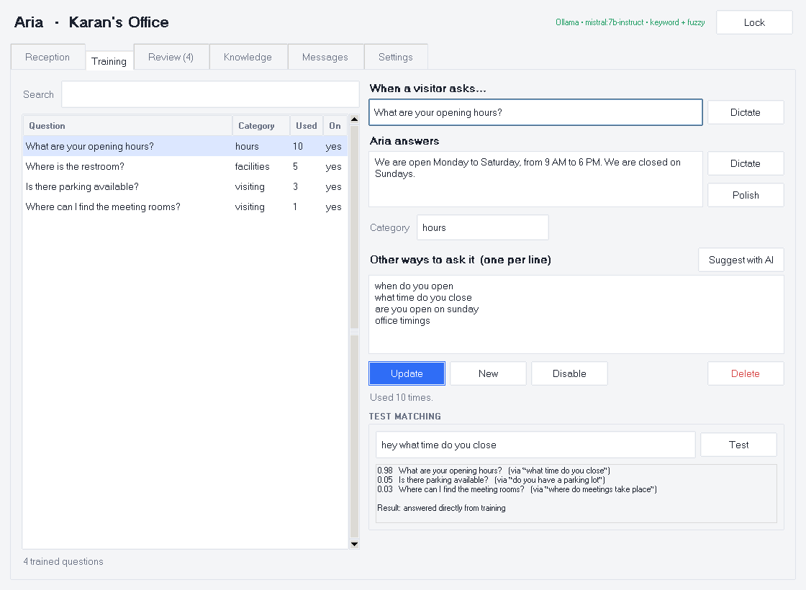
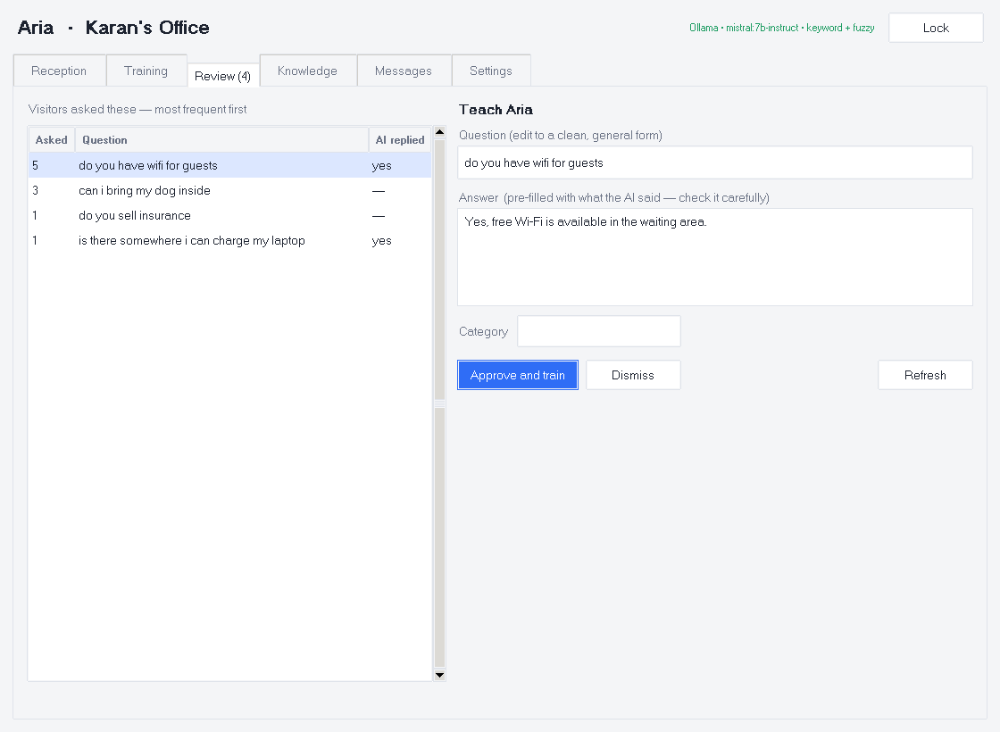
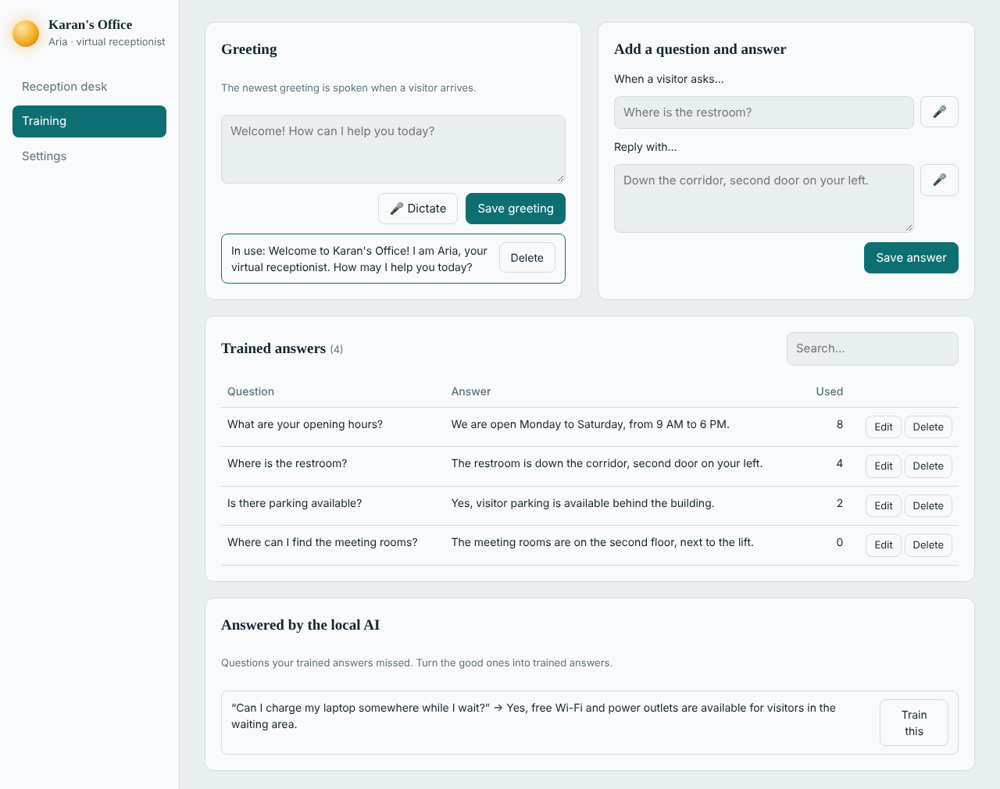
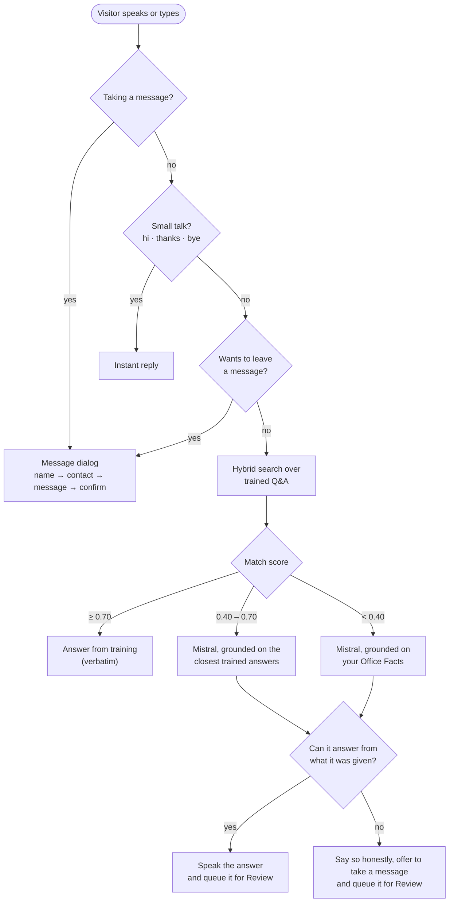
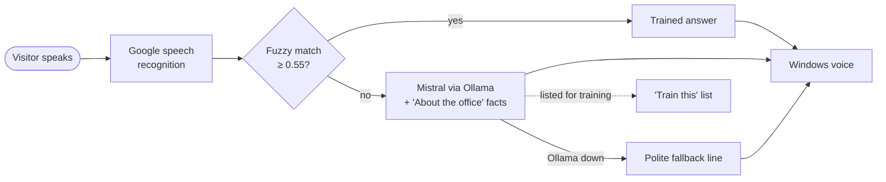

<h1 align="center">Receptionist AI</h1>

<p align="center">
  <b>A trainable voice receptionist for your front desk.</b><br>
  Teach it your office once. It greets visitors, answers by voice and takes messages.<br>
  When it hasn't been taught something, a local <a href="https://ollama.com">Ollama</a> model (Mistral) answers from <i>your</i> facts instead of guessing.
</p>

<p align="center">
  
  
  
  
</p>

<p align="center">
  <a href="#quick-start">Quick start</a> ·
  <a href="#two-apps-one-idea">Which app?</a> ·
  <a href="#how-it-works">How it works</a> ·
  <a href="#teaching-your-receptionist">Teaching it</a> ·
  <a href="#configuration">Configuration</a> ·
  <a href="#troubleshooting">Troubleshooting</a>
</p>

<p align="center">
  
  
</p>
<p align="center"><sub>Left: the web app. Right: the desktop app. Demo data; the model replies in these captures are illustrative.</sub></p>

---

## Highlights

- **Your answers come first.** Questions you've trained are answered in your own words, instantly, with no model involved.
- **A local model for everything else.** Anything untrained goes to Mistral running in Ollama on your own machine. It is told to answer only from your office facts and trained answers, and to admit when it can't.
- **It learns from real visitors.** Every question the AI had to handle lands in a review list. Approve a good answer and Aria knows it from then on.
- **Voice in, voice out.** Hands-free reception mode listens, thinks and speaks. A typed test box lets you try everything without a microphone.
- **Takes messages** *(desktop app)*. If Aria can't help, she offers to record the visitor's name, contact and message for your team.
- **Your data stays with you.** Training data lives in local SQLite files and the language model runs locally. The one exception is voice recognition; see [Privacy and security](#privacy-and-security).

## Two apps, one idea

This repository contains two front ends for the same idea. They keep **separate databases** that are not interchangeable.

| | **Desktop app** (`desktop_app_assistant`) | **Web app** (`web_assistant`) |
|---|---|---|
| Interface | Tkinter window with six tabs | Browser UI at `127.0.0.1:8000` with an animated pixel-art receptionist |
| Stack | Tkinter, SQLite, and an Ollama client with no third-party dependencies | FastAPI, uvicorn, plain JavaScript, SQLite |
| Matching | Hybrid: synonyms, stemming, typo tolerance, optional embeddings, several phrasings per answer | Fuzzy string match with a keyword boost |
| Local AI | Mistral streamed sentence by sentence, grounded on Office Facts and the closest trained answers | Mistral, one-shot reply, grounded on the "About the office" text |
| Learning loop | **Review** queue, ranked by how often visitors ask, with AI-drafted answers | "Answered by the local AI" list with a **Train this** button |
| Visitor messages | Yes (spoken dialog and an inbox) | No |
| Speech handling | Interruptible speech, adaptive microphone noise floor, mic closed while speaking | Blocking speech, fixed microphone threshold |
| Extras | JSON import/export, match tester, AI phrasing suggestions, answer polishing, terminal mode | Animated receptionist, typed test box with a "Speak reply" option |
| Automated tests | 32 unit tests plus a GUI smoke test | None yet |

**Which one?** Use the **desktop app** for a real front desk: it has the smarter matching, the review loop and message taking, and it is the one with tests. Use the **web app** if you want the animated receptionist or prefer a browser interface.

<p align="center">
  
  
</p>
<p align="center"><sub>Desktop app: training with alternate phrasings and a match tester (left), and the Review queue (right).</sub></p>

## Quick start

### Prerequisites

1. **Windows 10 or 11.** Spoken replies use the built-in Windows voices (SAPI). See [Limitations](#limitations-and-ideas) for other systems.
2. **Python 3.10 or newer** from [python.org](https://www.python.org/downloads/). Tick *Add Python to PATH*. The installer includes Tkinter.
3. **[Ollama](https://ollama.com) with a model.** Install it, then in a terminal:
   ```bat
   ollama pull mistral
   ollama list
   ```
   Note the exact model name that `ollama list` prints, for example `mistral:latest`.
4. **A microphone** for voice mode. Typing works without one.

### Desktop app

```bat
git clone https://github.com/sjkaran/receptionist_ai.git
cd receptionist_ai\desktop_app_assistant
pip install -r requirements.txt
python main.py
```

After the first install you can also double-click `run.bat`. For a terminal-only chat, run `python main.py --cli`.

1. Open **Settings**, choose your chat model (leave it blank to auto-pick a model whose name contains "mistral"), then press **Test connection** and **Save settings**.
2. The trainer tabs are protected by a PIN. The default is **1234**, so change it under *Settings → Trainer PIN*.
3. On a first run with an empty database, a few sample entries (category `sample`) are loaded so you can try it straight away. Delete them when you add your own.
4. *Optional:* run `ollama pull nomic-embed-text` and enter `nomic-embed-text` as the **Embedding model** to match paraphrases by meaning, not just by words.

### Web app

```bat
cd receptionist_ai\web_assistant
run.bat
```

`run.bat` creates a `.venv`, installs the requirements on the first run, starts the server and opens **http://127.0.0.1:8000** in your browser. To do the same by hand (any OS):

```bash
cd web_assistant
python -m venv .venv
.venv\Scripts\activate        # macOS/Linux: source .venv/bin/activate
pip install -r requirements.txt
python app.py
```

Open **Training** and unlock it with PIN **1234**. Then open **Settings**, confirm the **Ollama model** matches `ollama list` and fill in **About the office** so the AI has facts to work from. Saving settings requires the Training tab to be unlocked first.

<p align="center">
  
</p>
<p align="center"><sub>Web app: the Training tab, including the "Answered by the local AI" list with its <b>Train this</b> button.</sub></p>

### A quick tour of the desktop app

| Tab | What it is for |
|---|---|
| **Reception** | The live conversation. Type, or press *Start voice reception* for hands-free mode, which also locks the trainer tabs. Each reply shows where it came from (trained answer, local AI, small talk) and its match score. |
| **Training** | Add and edit Q&A. Add alternate phrasings, press *Suggest with AI*, *Polish* an answer for speaking, or *Dictate* by voice. **Test matching** shows exactly what Aria would do with any phrase. |
| **Review** | Questions visitors asked that training didn't cover. Edit the wording, then *Approve and train*. |
| **Knowledge** | **Office Facts** (the ground truth the AI may use), greetings, and JSON import/export for backups. |
| **Messages** | Messages visitors left, with name and contact. Mark them handled. |
| **Settings** | Model pickers, thresholds, voice, speech language and PIN. |

In the web app, **Reception desk** runs the conversation, **Training** manages the greeting, Q&A and the AI-answered list, and **Settings** holds the configuration. Say "stop assistant" to end voice mode in either app.

## How it works

### Desktop app



- **Matching** blends keyword weight, how much of a trained question the visitor's words cover, character-level similarity (which absorbs speech-to-text typos) and, if you set an embedding model, similarity of meaning. Synonyms such as *washroom = restroom* are folded together, and every answer can have several alternate phrasings.
- **Follow-ups** such as "and on Sunday?" borrow the previous topic, but only when their own words also appear in the matched entry, so an unrelated short question can't inherit the wrong answer.
- **Grounding.** The model is told to answer only from your Office Facts and trained answers, in at most two short spoken sentences. If it can't, it returns an internal marker that is never spoken. Aria says she doesn't know and offers to take a message instead.
- **If Ollama is unreachable**, Aria still answers from training when she is reasonably sure, and otherwise says so honestly.
- **The thresholds** (0.70 and 0.40) are adjustable in Settings.

### Web app



The browser polls the server for status and new messages, and the pixel-art receptionist reacts to the assistant's state: off duty, listening, thinking and speaking.

## Teaching your receptionist

1. **Write your Office Facts.** These are short, true statements such as hours, address, phone number, floors and policies. They are what lets Mistral answer questions you never trained, without inventing anything. *(Desktop: Knowledge → Office facts. Web: Settings → About the office.)*
2. **Train the questions people ask most.** Give each answer a clear question and a short, speakable reply. In the desktop app, add 3–6 alternate phrasings, because speech recognition hears things differently than you type them.
3. **Test it.** Use **Test matching** (desktop) or the typed test box (web) to see what happens with real phrasings before going live.
4. **Review regularly.** Open **Review** (desktop) or **Answered by the local AI** (web) and promote the good answers. The most-asked questions come first in the desktop app.
5. **Back up.** Desktop: Knowledge → *Export training…* writes a JSON file. Web: copy `web_assistant/data/reception.db`.

Keep spoken answers to one or two sentences, and keep your Office Facts accurate: they are what the AI relies on.

## Configuration

Settings are saved to `data/settings.json` inside each app's folder and are mostly editable from the UI. A few advanced options live only in the file. Close the app before editing it by hand.

<details>
<summary><b>Desktop app settings</b></summary>

| Setting | Default | In the UI? | Meaning |
|---|---|---|---|
| `office_name`, `assistant_name` | `Karan's Office`, `Aria` | yes | Used in the window title, greetings and the AI prompt |
| `ollama_url` | `http://localhost:11434` | yes | Where Ollama is listening |
| `ollama_model` | blank | yes | Blank auto-picks a model whose name contains "mistral" (otherwise the first installed model) |
| `embed_model` | blank (off) | yes | e.g. `nomic-embed-text` to add meaning-based matching |
| `temperature` | `0.3` | yes ("AI creativity") | Lower is more predictable |
| `match_threshold` | `0.70` | yes | At or above this score, answer straight from training |
| `suggest_threshold` | `0.40` | yes | At or above this, the closest answers are given to the AI as reference |
| `speak_replies` | `true` | yes | Speak replies aloud |
| `voice_hint` | `zira,hazel,female` | yes | Comma-separated voice-name hints; the first installed voice matching any of them is used |
| `stt_language` | `en-IN` | yes | Speech recognition language, e.g. `en-US`, `en-GB`, `hi-IN` |
| `num_predict` | `160` | file only | Maximum tokens per AI answer |
| `llm_timeout` | `90` | file only | Seconds to wait for Ollama |
| `voice_rate` | `1` | file only | Speech speed (-10 to 10) |
| `mic_timeout` | `10` | file only | Seconds to wait for a visitor to start speaking |
| `phrase_limit` | `20` | file only | Longest single utterance, in seconds |
| `end_silence` | `1.1` | file only | Seconds of silence that end an utterance |
| `min_rms` | `350` | file only | Floor for the adaptive silence threshold (lower hears quieter voices) |

</details>

<details>
<summary><b>Web app settings</b></summary>

| Setting | Default | In the UI? | Meaning |
|---|---|---|---|
| `office_name`, `assistant_name` | `Karan's Office`, `Aria` | yes | Branding and the AI prompt |
| `office_info` | blank | yes ("About the office") | Facts the AI may use |
| `ollama_url`, `ollama_model` | `http://localhost:11434`, `mistral` | yes | Ollama address and model name |
| `similarity_threshold` | `0.55` | yes ("Match strictness") | Higher is stricter |
| `silence_rms` | `500` | yes ("Mic sensitivity") | Microphone level treated as speech; lower hears quieter voices |
| `voice_hint`, `speech_rate` | `zira,hazel,female`, `1` | yes | Windows voice preference and speed (-10 to 10) |
| `trainer_pin` | `1234` | yes | Leave the field blank to keep the current PIN |
| `ollama_timeout` | `90` | file only | Seconds to wait for Ollama |
| `listen_timeout`, `phrase_limit` | `10`, `20` | file only | Seconds to wait for speech, and longest utterance |

</details>

## Project structure

```
receptionist_ai/
├── desktop_app_assistant/        # "Aria": Tkinter desktop app
│   ├── main.py                   # entry point (python main.py, or --cli for a terminal chat)
│   ├── run.bat
│   ├── requirements.txt
│   ├── aria/
│   │   ├── brain.py              # decision pipeline, grounded prompt, message dialog, learning loop
│   │   ├── retriever.py          # hybrid scoring: keywords, synonyms, typos, optional embeddings
│   │   ├── llm.py                # Ollama client (standard library only): streaming chat, embeddings
│   │   ├── speech.py             # interruptible speech queue + noise-adaptive microphone → Google STT
│   │   ├── session.py            # hands-free loop: greet → listen → think → speak
│   │   ├── database.py           # SQLite: Q&A, phrasings, facts, greetings, review queue, messages, log
│   │   ├── textutils.py          # normalising, stemming, synonyms, small-talk intents
│   │   ├── config.py             # settings and PIN hashing
│   │   ├── context.py            # wires everything together
│   │   └── ui/                   # one file per tab, plus the app shell and widgets
│   └── tests/                    # engine, mock-Ollama HTTP, speaker, and a GUI smoke test
└── web_assistant/                # FastAPI backend + browser UI
    ├── app.py                    # entry point: starts the server and opens the browser
    ├── run.bat                   # creates .venv, installs requirements, launches
    ├── config.py                 # settings → data/settings.json
    ├── core/
    │   ├── assistant.py          # reception loop, state machine, event feed
    │   ├── matcher.py            # fuzzy matching (SequenceMatcher + keyword boost)
    │   ├── llm.py                # Ollama client (/api/chat) and health check
    │   ├── stt.py                # sounddevice recording + Google recognition
    │   ├── tts.py                # Windows SAPI voice
    │   └── database.py           # SQLite: greetings, Q&A, conversation log
    └── web/
        ├── server.py             # FastAPI JSON API
        └── static/               # index.html, app.js, receptionist.js (pixel-art portrait), style.css
```

Each app creates its own `data/` folder on first run (`reception.db`, `settings.json`).

## Tests

The desktop app ships with 32 unit tests and a GUI smoke test. Run them from `desktop_app_assistant/`:

```bash
python tests/test_engine.py       # retrieval quality, dialog flows, learning loop, database
python tests/test_llm_http.py     # the real Ollama client against a mock Ollama server
python tests/test_speaker.py      # speech queue and interruption behaviour
python tests/ui_smoke.py          # drives every tab (needs a display)
```

On a headless Linux machine, run the last one as `xvfb-run -a python tests/ui_smoke.py`. No test needs Ollama, a microphone or speakers. The web app has no automated tests yet.

## Troubleshooting

| Symptom | Fix |
|---|---|
| **"Ollama is not running"** / the status dot is red | Start Ollama (the app, or `ollama serve`) and check the address in Settings (default `http://localhost:11434`). The desktop app keeps answering from training meanwhile. |
| **"Model … not found" / "not installed"** | Run `ollama pull mistral`, then run `ollama list` and put the **exact** name (for example `mistral:latest`) into the model setting. |
| **Web app says "AI ready" but replies fall back to "having trouble"** | The health check matches model names loosely (`mistral` matches `mistral:7b-instruct`), but chat requests use the name exactly as typed. Set the full name shown by `ollama list`. |
| First answer after a pause is slow | Ollama is loading the model. The desktop app warms it up at start and keeps it loaded for 30 minutes. |
| No voice input, or a microphone error | Run `pip install -r requirements.txt` again and make sure the right microphone is the Windows default. On Linux install PortAudio (`sudo apt install libportaudio2`). Typing always works. |
| Speech is misheard, or the wrong accent | Desktop: set **Speech language** in Settings (`en-US`, `en-GB`, `hi-IN`, …). The web app uses Google's default language (US English). |
| It cuts me off, or misses quiet voices | Web: lower **Mic sensitivity** in Settings. Desktop: the noise floor adapts on its own; for fine tuning edit `min_rms` and `end_silence` in `settings.json`. |
| No spoken replies | On Windows run `pip install pywin32`. Desktop: tick **Speak replies** and check the voice name hints. Web: the Voice indicator in the sidebar shows whether a voice is available. |
| Tkinter import error on Linux | `sudo apt install python3-tk` |
| Web app: port 8000 already in use | Change `PORT` in `web_assistant/app.py`. |
| Forgot the PIN | Desktop: delete the `pin_hash` entry from `data/settings.json` to go back to `1234`. Web: edit `trainer_pin` in `data/settings.json`. Deleting the file resets every setting but keeps your training data. |

## Privacy and security

- **Your training data and the language model stay on your machine.** Q&A, facts, greetings, messages and conversation logs are stored in local SQLite files, and Mistral runs in your own Ollama.
- **Voice recognition is the exception.** Both apps send the recorded audio to Google's free speech recognition service through the [`SpeechRecognition`](https://pypi.org/project/SpeechRecognition/) package, so voice mode needs an internet connection. Typed input is fully offline.
- **Keep `data/` out of version control.** It holds visitor conversations and messages. Add `data/*.db*` and `data/settings.json` to your `.gitignore`.
- **PIN storage.** The desktop app stores only a hash of the trainer PIN. The web app stores the PIN in plain text in `data/settings.json` and sends it in an `X-Pin` header.
- **Run the web app on this machine only.** It binds to `127.0.0.1`. Don't expose it to a network: the PIN protects the trainer and settings endpoints, but reception controls and the live event feed are open.

## Limitations and ideas

**Limitations**

- Voice recognition needs internet access (see above).
- Spoken output is Windows-first. The desktop app can fall back to `say` (macOS) or `espeak` (Linux); the web app's voice is Windows only. Typing works everywhere.
- A small local model can still occasionally be wrong. The grounding prompt reduces this but cannot rule it out, so keep Office Facts accurate and skim the review list.
- One visitor at a time, and no telephony: it is designed for a front-desk device.
- The web app uses the original fuzzy matcher and non-streaming replies, and recognises US English only.

**Ideas for next**

- Bring the desktop engine's hybrid matching, streaming, review queue and message taking to the web app.
- Offline speech recognition (Whisper or Vosk) for a fully offline setup.
- Staff notifications when a visitor leaves a message.
- Multi-language support and a microphone device picker.

---

<p align="center">
  Built by <a href="https://github.com/sjkaran">Karan</a> with
  <a href="https://ollama.com">Ollama</a> · <a href="https://mistral.ai">Mistral</a> · <a href="https://fastapi.tiangolo.com">FastAPI</a> ·
  Tkinter · SQLite · <a href="https://pypi.org/project/SpeechRecognition/">SpeechRecognition</a> · <a href="https://python-sounddevice.readthedocs.io">sounddevice</a>
</p>
